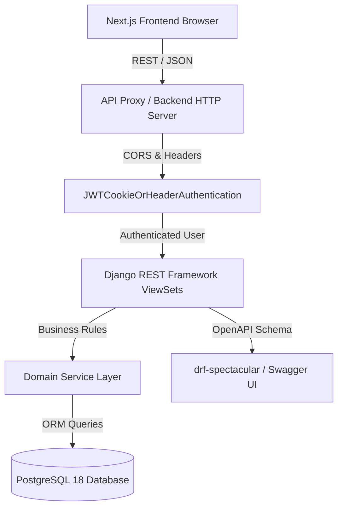
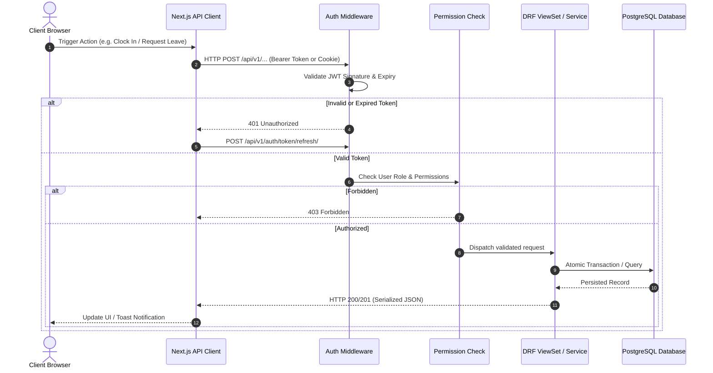
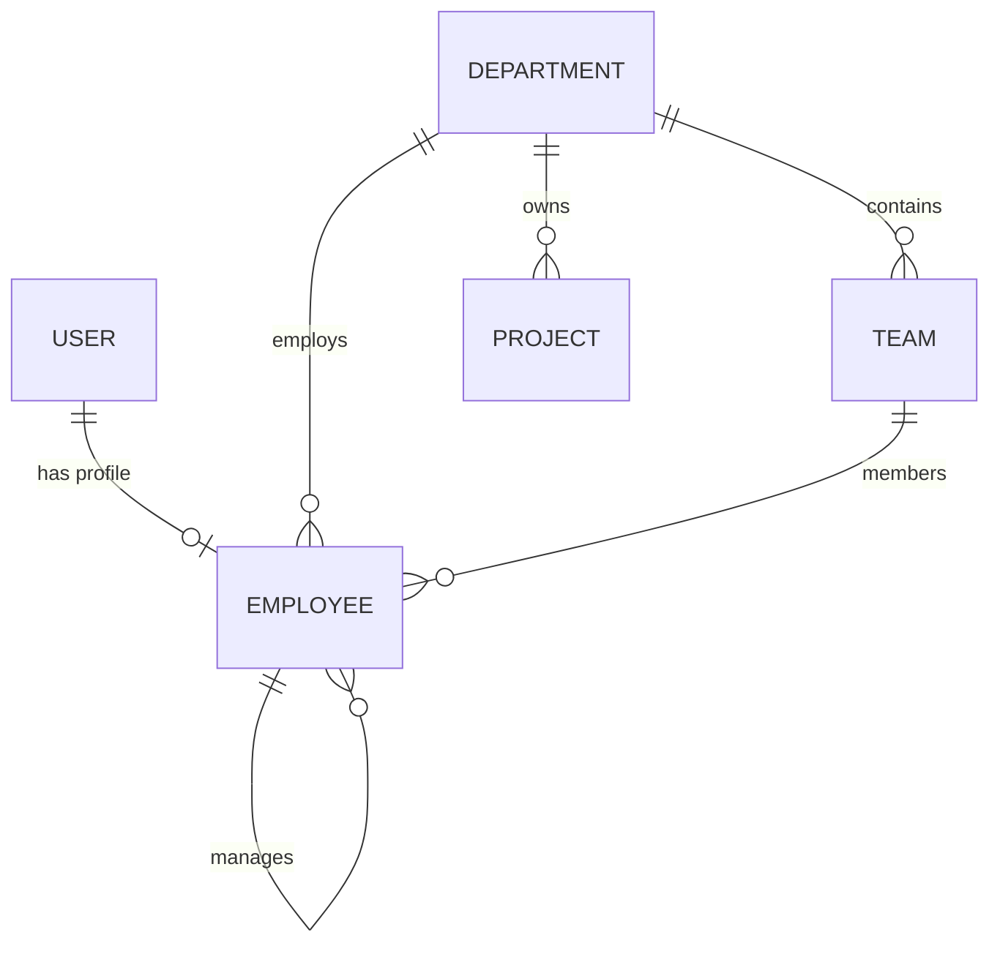
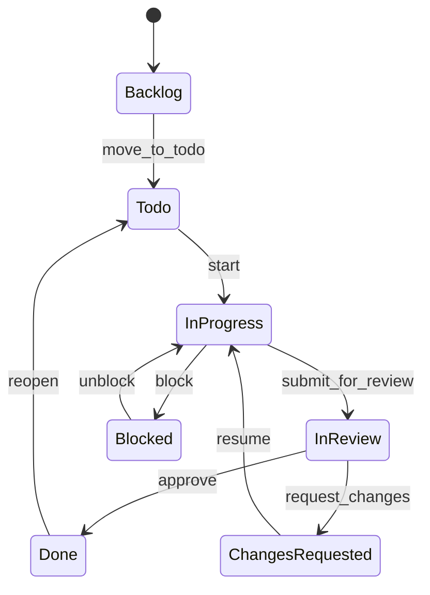
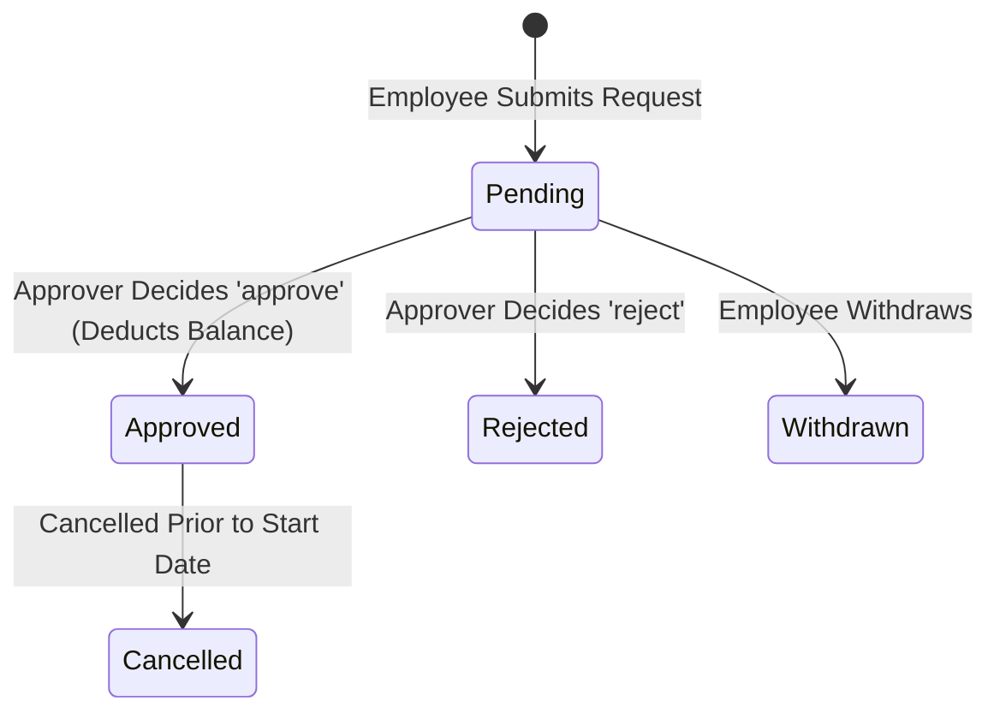

# System Architecture — Employee Management System

## 1. Project Overview
Employee Management System (Workforce Hub) is a full-stack enterprise Human Resource Management System (HRMS). It delivers authenticated employee and HR operations across workforce directory, department/team hierarchies, project task tracking, attendance clocking, leave management, multi-step approval routing, notifications, and role-scoped reporting.

## 2. Architectural Goals
- **Maintainability & Monorepo Cohesion**: Unified monorepo containing `frontend/` and `backend/` with aligned data contracts and automated development skills.
- **Strict Server-Side Security**: The client interface is never a security boundary. All authentication, role authorization, and data isolation are enforced authoritatively on the Django REST Framework server.
- **Contract Fidelity**: Single source of truth for API schemas and data types between Next.js TypeScript definitions and DRF serializers.
- **Safe Evolutionary Migrations**: Predictable schema evolution with zero data loss and automated rollback capabilities.

## 3. Monorepo Structure
```text
Employee-Management-System/
├── frontend/                         # Next.js 15+ App Router, Tailwind CSS, Radix UI
│   ├── src/
│   │   ├── app/                      # Page routes & layouts
│   │   ├── components/               # Design system & shared UI
│   │   ├── features/                 # Domain-driven screens (auth, tasks, leave, etc.)
│   │   ├── lib/api/                  # Typed client & API services
│   │   └── types/                    # Canonical TypeScript interfaces
├── backend/                          # Django 5.x / Django REST Framework
│   ├── manage.py
│   ├── config/                       # Settings split (base, dev, prod), URLs, WSGI/ASGI
│   ├── apps/
│   │   ├── common/                   # Base models, pagination, error handling, permissions
│   │   ├── accounts/                 # Custom User model, JWT authentication, cookies
│   │   ├── organisations/            # Organisation settings, departments, teams, projects
│   │   └── employees/                # Employee profiles, employment status, sensitive gating
│   ├── requirements/                 # base.txt, local.txt, production.txt
│   └── tests/                        # Automated test suite
├── docs/                             # Comprehensive system documentation
└── .agent/skills/ & .agents/skills/  # Antigravity development skills
```

## 4. Frontend & Backend Responsibilities
- **Frontend**: Presentation, client-side validation, UI state management (optimistic updates, loading, error, empty states), navigation, routing, and role-aware UI display.
- **Backend**: Authoritative authentication, JWT token issuance and rotation, fine-grained RBAC permission enforcement, business workflows (task state machines, leave balance ledgers, punch tracking), database persistence, audit logging, and reporting aggregations.

## 5. High-Level System Architecture


## 6. API Request Lifecycle


## 7. Django Application Boundaries
- `apps.common`: Shared foundation (`TimeStampedModel`, `UUIDModel`, `StandardResultsSetPagination`, custom exception handling).
- `apps.accounts`: Custom `User` model, email authentication, Simple JWT cookies and headers, password reset, and invitation acceptance.
- `apps.organisations`: Organisation settings, corporate structure (`Department`, `Team`), and corporate `Project` catalog.
- `apps.employees`: Employee directory, profile updates, employment types, status tracking, and sensitive field filtering.

## 8. Authentication Architecture
- Supports dual authentication strategies matching frontend configuration (`NEXT_PUBLIC_AUTH_STRATEGY`):
  1. **Cookie Strategy**: Server sets HttpOnly `wf_access` and `wf_refresh` cookies on `/api/v1/auth/login/` and `/api/v1/auth/token/refresh/`. Frontend uses `credentials: "include"` and passes `X-CSRFToken` for mutating requests.
  2. **Bearer Strategy**: Frontend receives tokens in JSON response and transmits `Authorization: Bearer <access_token>` in memory.
- Token refresh: Automated refresh on 401 response; token rotation and blacklisting enabled.

## 9. Authorization and Access-Control Model
- **Roles**: `super_admin`, `hr_admin`, `manager`, `project_manager`, `employee`, `auditor`.
- **Granular Permissions**: String-based permission list attached to user records (e.g., `employees.view_sensitive`, `departments.manage`, `tasks.assign`).
- **Data Scoping**:
  - `super_admin` & `hr_admin`: Organisation-wide access.
  - `manager` & `project_manager`: Scoped to direct reports, department, or assigned projects.
  - `employee`: Scoped to self and public directory info.

## 10. Sensitive Data Isolation
- Sensitive fields such as `salary_band`, `date_of_birth`, personal phone, and emergency contact details are filtered at serializer representation level (`to_representation()`). Non-HR users cannot access these fields even if querying `/api/v1/employees/{id}/`.

## 11. Core Domain Relationships


## 12. Task State Machine


## 13. Leave Request & Approval Lifecycle


## 14. Testing Strategy
- Pytest test runner with `pytest-django`.
- Independent database transactions per test.
- Coverage requirements: Unit tests for models and services, integration tests for API endpoints and permission gates.
