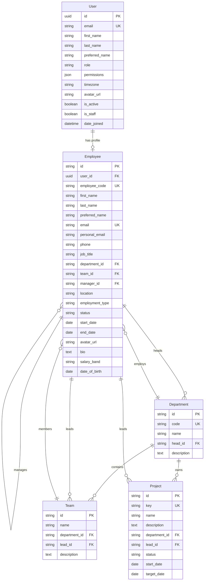

# Data Model — Employee Management System

## 1. Overview
The database layer is built using Django ORM backed by PostgreSQL 18. Primary keys across core domain models utilize UUIDs or prefixed identifier strings (e.g., `emp_<hex>`, `dept_<hex>`, `prj_<hex>`) matching frontend conventions.

## 2. Entity-Relationship Diagram (ERD)

## 3. Core Database Entities

### 3.1 `accounts.User`
- **Table**: `accounts_user`
- **Purpose**: Authenticated identity and credential management.
- **Fields**:
  - `id` (`UUIDField`, Primary Key)
  - `email` (`EmailField`, Unique, Indexed)
  - `role` (`CharField`, choices: `super_admin`, `hr_admin`, `manager`, `project_manager`, `employee`, `auditor`)
  - `permissions` (`JSONField`, list of granted capability strings)
  - `timezone` (`CharField`, default `UTC`)
  - `is_active` (`BooleanField`, default `True`)
  - `is_staff` (`BooleanField`, default `False`)

### 3.2 `employees.Employee`
- **Table**: `employees_employee`
- **Purpose**: Full employment profile and reporting relationships.
- **Fields**:
  - `id` (`CharField(64)`, Primary Key)
  - `user` (`OneToOneField` to `accounts.User`, optional)
  - `employee_code` (`CharField`, Unique, Indexed)
  - `department` (`ForeignKey` to `organisations.Department`, `on_delete=models.PROTECT`)
  - `team` (`ForeignKey` to `organisations.Team`, `on_delete=models.SET_NULL`, nullable)
  - `manager` (`ForeignKey` to `employees.Employee`, self-referential direct report tree)
  - `salary_band` (`CharField`, protected by `employees.view_sensitive`)
  - `date_of_birth` (`DateField`, protected by `employees.view_sensitive`)

### 3.3 `organisations.Department`
- **Table**: `organisations_department`
- **Fields**: `id`, `code` (Unique), `name`, `head` (ForeignKey to Employee, nullable), `description`.

### 3.4 `organisations.Team`
- **Table**: `organisations_team`
- **Fields**: `id`, `name`, `department` (ForeignKey), `lead` (ForeignKey to Employee, nullable), `description`.

### 3.5 `organisations.Project`
- **Table**: `organisations_project`
- **Fields**: `id`, `key` (Unique), `name`, `department` (ForeignKey), `lead` (ForeignKey to Employee), `status` (`planned`, `active`, `on_hold`, `completed`), `start_date`, `target_date`.

### 3.6 `tasks.Task` & Workflow Engine
- **Tables**: `tasks_task`, `tasks_taskcomment`, `tasks_taskevent`, `tasks_taskattachment`
- **Fields (`Task`)**: `id`, `key` (`WF-101`), `title`, `description`, `project` (FK), `department` (FK), `team` (FK, nullable), `assignee` (FK, nullable), `reporter` (FK), `reviewer` (FK, nullable), `priority` (`urgent`, `high`, `medium`, `low`), `status` (`draft`, `todo`, `in_progress`, `in_review`, `changes_requested`, `blocked`, `done`, `cancelled`), `assignment_state`, `rejection_reason`, `clarification_note`, `block_reason`, `start_date`, `due_date`, `labels`.
- **Transitions Engine**: `start`, `submit_for_review`, `approve`, `request_changes`, `block`, `unblock`, `cancel`, `reopen` enforcing role and state prerequisites.

### 3.7 `attendance.AttendanceRecord` & `AttendanceCorrection`
- **Tables**: `attendance_attendancerecord`, `attendance_attendancecorrection`
- **Fields (`AttendanceRecord`)**: `id`, `employee` (FK), `department` (FK), `date`, `clock_in_at`, `clock_out_at`, `break_started_at`, `break_minutes`, `worked_minutes`, `status` (`present`, `absent`, `late`, `leave`, `holiday`), `exceptions` (array of flags like `"late"`), `timezone`.
- **Fields (`AttendanceCorrection`)**: `id`, `employee` (FK), `date`, `requested_clock_in_at`, `requested_clock_out_at`, `reason`, `status`, `reviewer_comment`, `decided_at`.

### 3.8 `leave_management.LeaveType`, `LeaveBalance`, `LeaveRequest`
- **Tables**: `leave_management_leavetype`, `leave_management_leavebalance`, `leave_management_leaverequest`
- **Ledger Model**:
  - `allocated_days`: Total policy allowance (e.g. 20 days annual leave).
  - `used_days`: Days spent from approved requests.
  - `pending_days`: Days reserved for pending requests.
  - `available_days` (computed property): `allocated - used - pending`.
- **Fields (`LeaveRequest`)**: `id`, `employee` (FK), `department` (FK), `leave_type` (FK), `start_date`, `end_date`, `partial_day` (`none`, `am`, `pm`), `days`, `reason`, `status` (`pending`, `approved`, `rejected`, `withdrawn`, `cancelled`), `reviewer_comment`.

### 3.9 `approvals.Approval`
- **Table**: `approvals_approval`
- **Fields**: `id`, `type` (`leave`, `attendance_correction`, `hr_request`), `subject_id`, `employee` (FK, requester), `approver` (FK, assignee), `decided_by` (FK, actor), `title`, `summary`, `status` (`pending`, `approved`, `rejected`, `changes_requested`), `comment`, `context` (JSON snapshot), `history` (audit trail), `submitted_at`, `decided_at`.

### 3.10 `notifications.Notification` & `NotificationPreferences`
- **Tables**: `notifications_notification`, `notifications_notificationpreferences`
- **Fields (`Notification`)**: `id`, `recipient` (FK to User), `title`, `message`, `category` (`task`, `approval`, `leave`, `attendance`, `system`), `tone` (`info`, `success`, `warning`, `danger`), `action_url`, `read_at`.
- **Fields (`NotificationPreferences`)**: `id`, `user` (OneToOne), `in_app_enabled`, `email_enabled`, `categories` (JSON enabled map).

## 4. Integrity Constraints & Foreign Keys
- Explicit `on_delete` behaviors:
  - `models.PROTECT` on Department to prevent accidental deletion of organizational units containing active employees.
  - `models.SET_NULL` on leadership roles (`head`, `lead`, `manager`) when an employee profile is deactivated or removed.
- Historical integrity: Employee deactivation sets `status = 'inactive'` and `user.is_active = False` rather than physical record deletion.
- Balance integrity: Leave requests deduct from `available_days` atomically inside database transactions, with rollbacks on request withdrawal or rejection.
